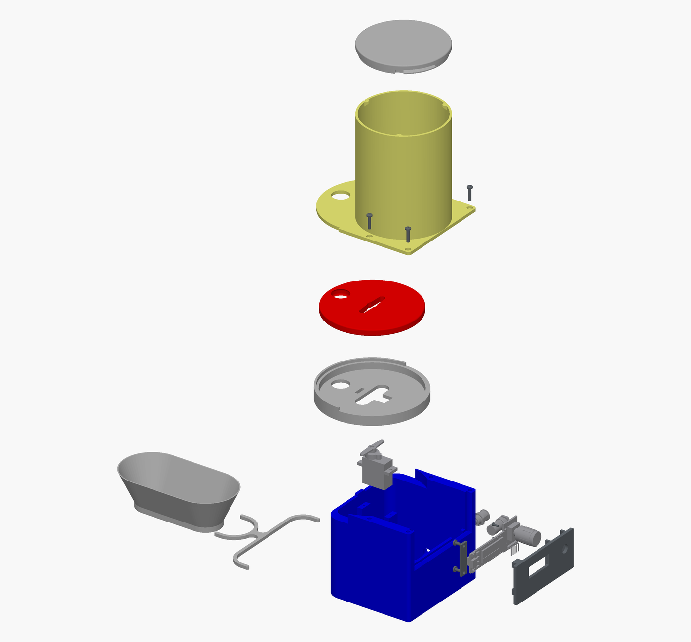

# Feeder – interaktive Explosionsansicht

[Interaktive 3D-Ansicht öffnen](Images/FeederExploded.html)

Das Vorschaubild verlinkt eine eigenständige HTML-Datei. Diese in einem aktuellen Browser mit WebGL-Unterstützung öffnen. Modell und Betrachter sind vollständig eingebettet; Internetverbindung und FreeCAD werden nicht benötigt. Der Markdown-Betrachter zeigt das Bild, der Link öffnet das interaktive Modell.

## Bedienung

- Ziehen dreht die Ansicht, das Mausrad zoomt.
- Umschalt + Ziehen verschiebt die Ansicht.
- Der Regler Explosion wechselt zwischen zusammengebautem und explodiertem Zustand.
- Die Kontrollkästchen blenden einzelne Bauteile aus; Alle anzeigen macht sie wieder sichtbar.
- Ansicht einpassen setzt Blickrichtung, Zoom und Verschiebung zurück.
- PNG speichern exportiert die aktuelle Modellansicht als Bild.
- Bei fokussierter Zeichenfläche drehen die Pfeiltasten, Plus/Minus zoomt und Pos1 passt die Ansicht ein.

## Modellquelle

Momentaufnahme aus [Feeder.FCStd](CAD/Feeder.FCStd), Stand 20. Oktober 2026: 22 Assembly-Komponenten und 17 gespeicherte Explosionsbewegungen. Die vernetzte Darstellung dient der Dokumentation; bearbeitbare Quelle bleibt das FreeCAD-Dokument. Nach Änderungen an CAD-Modell oder Explosionsbewegungen müssen HTML und Vorschaubild neu erzeugt werden. Zwischenstellungen des Reglers interpolieren die endgültigen Bauteilversätze; sie spielen nicht die einzelnen Montageschritte nacheinander ab.

[English description](ExplodedView.md)
