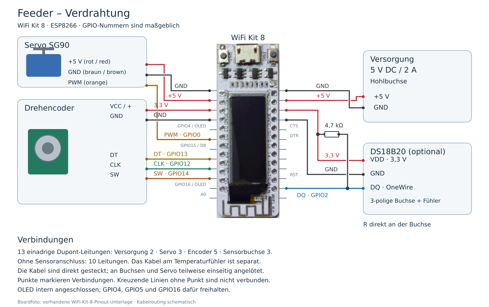

<!-- Feeder/Hw/README.DE.md, Version: 1.06 -->
# Feeder – Hardware

[English](README.md)

Der Feeder ist ein vollständiger Eigenentwurf. Hier liegen das mechanische CAD-Modell, Bilder und Unterlagen zu den verwendeten Elektronikmodulen sowie ihrem Zusammenbau. Die Elektronik verwendet ausschließlich gekaufte Module.

## Funktionsprinzip

Ein Servo dreht eine Dosierscheibe mit einer zylindrischen Aussparung bei jeder Fütterung um 180°. In einer Stellung läuft das Futter aus dem darüberliegenden Behälter in den Hohlraum. In der anderen Stellung fällt die dosierte Menge in das Aquarium.

## Variante FeederV2 mit O-Ring

Die Variante [FeederV2.FCStd](CAD/FeederV2.FCStd) ergänzt eine O-Ring-Nut in `Top` und einen O-Ring 22 × 2,5 mm (Innendurchmesser × Schnurstärke). Grund für die Änderung: Futter kann zwischen Dosierscheibe und Gehäuse klemmen. Der Ring soll dies mit etwa 0,2 mm Überstand verhindern. Konstruktion und Explosionsansicht sind im CAD aktualisiert und vom Ersteller visuell geprüft. Ein praktischer Test steht noch aus; Abdichtwirkung, Reibung, Servobelastung und Verschleiß sind noch zu prüfen. Der O-Ring-Werkstoff ist noch festzulegen.

`Feeder.FCStd` enthält weiterhin die bisherige Ausführung. Die unten verlinkte HTML-/PNG-Explosionsansicht zeigt diese Ausführung; die aktualisierte FeederV2-Explosionsansicht befindet sich in der CAD-Datei.

## Ablage

- `CAD/`: mechanische CAD-Daten mit Assembly und Explosionsansicht. Bearbeitbares Modell: [Feeder.FCStd](CAD/Feeder.FCStd).
- `Images/`: Fotos, Bedienungsbilder, Explosionsvorschau und die eigenständige HTML-3D-Ansicht.
- `Schematics/`: Schalt-, Anschluss- und Verdrahtungsunterlagen, darunter die Anschlussübersicht des WiFi-Kit-8-Moduls (manufacturer reference; not bundled).

## Explosionsansicht

[Interaktive 3D-Ansicht und Bedienung](ExplodedView.DE.md)

[](Images/FeederExploded.html)

Das Bild öffnet die offline nutzbare HTML-Ansicht. Das Modell lässt sich drehen, zoomen und mit dem Explosionsregler auseinanderziehen; einzelne Bauteile können ausgeblendet werden.

## Verkabelung

[](Schematics/FeederWiring.DE.svg)

[SVG zum Bearbeiten](Schematics/FeederWiring.DE.svg) · [Anschlussliste](Schematics/Wiring.DE.md)

Die Kabel sind direkt gesteckt. An den Buchsen und am Servo sind sie teilweise einseitig angelötet. Der 4,7-kΩ-Pull-up sitzt direkt an der Sensorbuchse zwischen Datenleitung und 3,3 V. Der Plan benötigt 13 einadrige Dupont-Leitungen mit Sensoranschluss, sonst 10. Das Kabel am Temperaturfühler zählt nicht dazu.

## Stückliste

[Stückliste](BOM.DE.md) · [ODS bearbeiten](BOM.ods)

Die Stückliste wird in `BOM.ods` gepflegt. Die Blätter `DE` und `EN` enthalten die deutsche und englische Sprachfassung. Mengen, Bezugsquellen und technische Angaben bei Änderungen in beiden Sprachblättern nachführen. Auch Teile ohne CAD-Modell sind enthalten. Bei Kaufbaugruppen mitgelieferte Teile nicht zusätzlich bestellen.

Die Spalten enthalten Position, Menge, CAD-Bezeichnung, Beschreibung, Hersteller/Anbieter, Bezugsquelle und Anmerkungsverweise. Zusätzliche Hinweise stehen unterhalb der Tabelle.

Nach dem Speichern der ODS werden beide Markdown-Sprachfassungen vom Prjs-Stamm aus aktualisiert:

```sh
python3 Aq/Feeder/tools/ExportCadBom.py --render-only
```

Ein CAD-Abgleich mit `python3 Aq/Feeder/tools/ExportCadBom.py` schreibt die aktuellen CAD-Mengen nach `generated/CAD-BOM.csv` im Projektstamm. Relevante Änderungen bei Bedarf in die ODS übernehmen. Die ODS wird vom Skript nicht verändert.

## Montage und Erstinbetriebnahme

**Coming soon – noch unvollständig.** Die schrittweise Montage, Sensor-Steckerkontakte, Kabellängen und Erstinbetriebnahme einschließlich Servo-Kalibrierung werden noch ergänzt. Die vorhandenen CAD-, Stücklisten- und Verdrahtungsunterlagen stehen bereits zur Verfügung. Rückmeldungen zum Nachbau sind willkommen.
