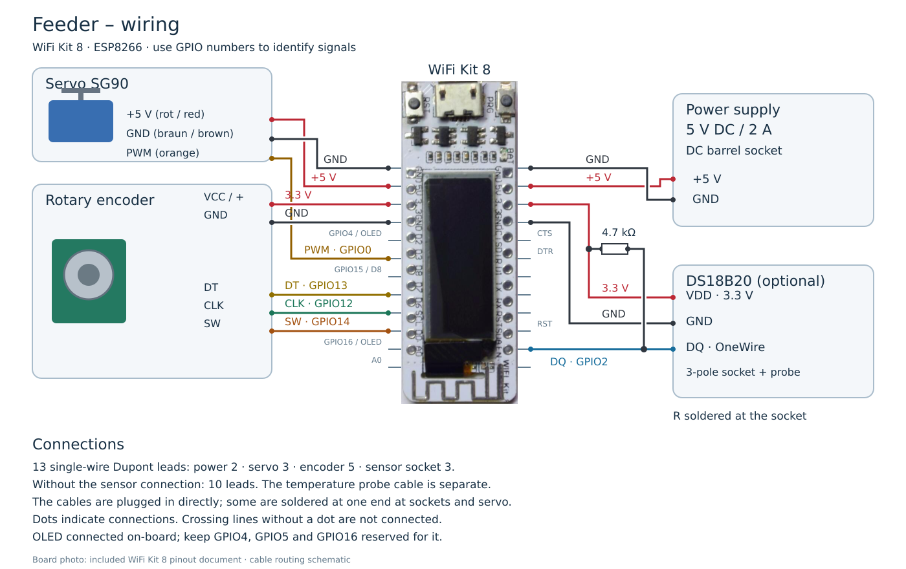

# Feeder – connection list

[Deutsch](Wiring.DE.md) · [Hardware](../README.md)

| Lead | WiFi Kit 8 | Other end |
| ---: | --- | --- |
| 1 | 5V | DC +5 V |
| 2 | GND | DC GND |
| 3 | 5V | SG90 +5 V |
| 4 | GND | SG90 GND |
| 5 | GPIO0 / D3 | SG90 PWM |
| 6 | 3V3 | Encoder VCC / + |
| 7 | GND | Encoder GND |
| 8 | GPIO13 / D7 | Encoder DT |
| 9 | GPIO12 / D6 | Encoder CLK |
| 10 | GPIO14 / D5 | Encoder SW |
| 11 | 3V3 | DS18B20 VDD |
| 12 | GND | DS18B20 GND |
| 13 | GPIO2 / D4 | DS18B20 DQ |

Leads 11–13 are required only for the optional temperature probe. The three signals pass through the sensor socket and matching cable connector to the DS18B20; connector contact numbers remain to be documented. Do not rely on wire colours alone.

Solder the 4.7 kΩ resistor directly at the socket between 3.3 V and DQ; it needs no separate Dupont lead. The cables are plugged directly onto the pin headers; at the sockets and servo, some are soldered at one end. Determine cable lengths during assembly.

The OLED is already connected on-board. GPIO4, GPIO5 and GPIO16 remain reserved for it. GPIO2 is used for OneWire; GPIO15/D8 is unsuitable. The encoder and DS18B20 use 3.3 V; the servo uses 5 V. All modules share ground.

Wire the DC socket to match the selected power supply polarity. The diagram shows only the 5 V side. Based on the pin assignments in `Sw/Feeder.ino`, active servo/encoder/Dallas pin values and the included WiFi Kit 8 pinout (manufacturer reference; not bundled). The illustration represents an equivalent functional arrangement; cable routing is schematic.
