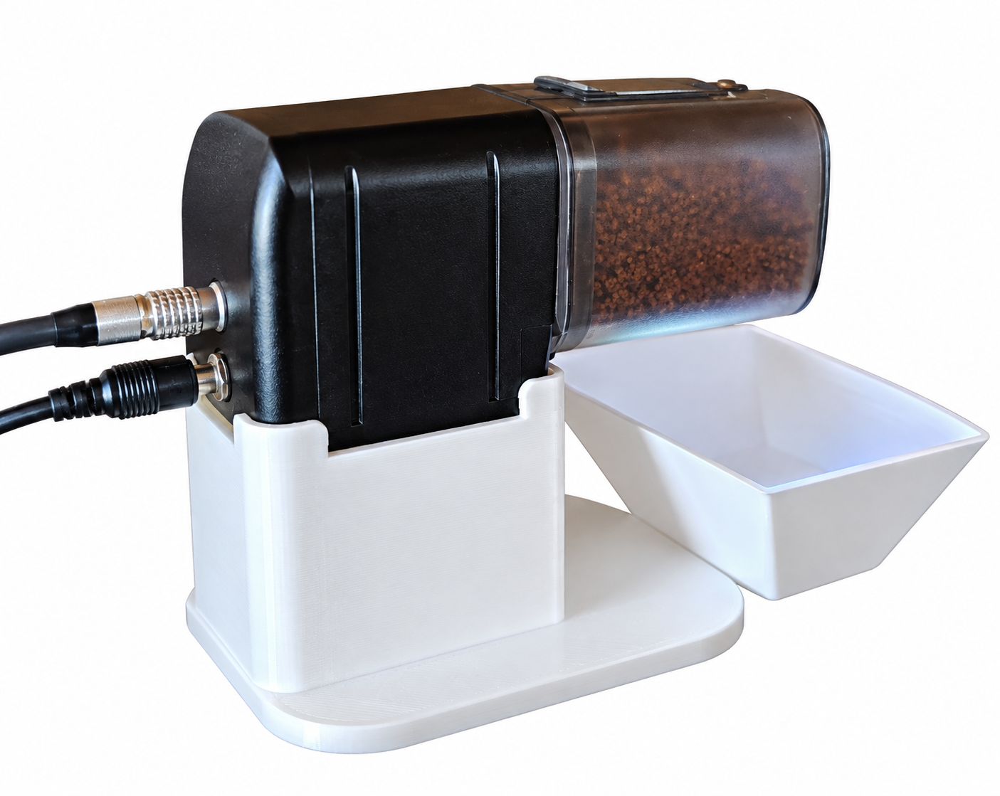

# FeederSimple – Hardware

[English](README.md)

**Coming soon – unvollständig.** FeederSimple ist der Umbau eines gekauften Futterautomaten. Die Originalsteuerung wird ersetzt; die vorhandene Platine und Mechanik werden weiterverwendet. Bestätigte Signalbelegungen und aktuelle Firmwarevorgaben stehen in der [Projekt-README](../README.md).

Noch zu ergänzen: genaue Bezeichnung des Ausgangsgeräts, vollständige Verkabelung, Stückliste, Umbau- und Montageschritte sowie verwendete CAD-/STL-Unterlagen.
