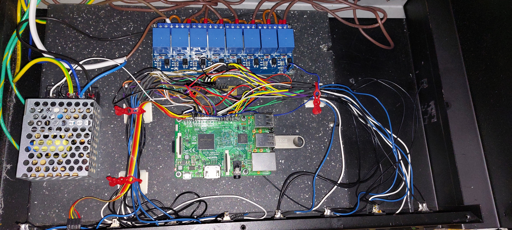

# MultiTimer / Dashboard – Raspberry Pi hardware

[Deutsch](README.DE.md)

**Coming soon – hardware documentation is incomplete.** The existing assembly uses a Raspberry Pi 3 Model B, an eight-channel relay board and a power supply in a Conrad IR Powermanager housing. MultiTimer and Dashboard run as separate services on the same Pi. A separate service is prepared for the room-temperature sensor; physical installation and testing are pending. The battery sender runs on the laptop.

## Existing documents

More photos: [20261019_093611](Images/20261019_093611.jpg) · [20261019_093616](Images/20261019_093616.jpg) · [20261019_093928](Images/20261019_093928.jpg) · [20261019_094013](Images/20261019_094013.jpg)

Relay module document (German) (manufacturer reference; not bundled) · [Sensor plate (STL)](CAD/SensorPlate.stl) · [Room-temperature sender](../../RoomTemperature/README.md)

## Still to document

Complete bill of materials including power supply and relay board models, wiring diagram, GPIO/channel/socket assignment, and assembly and enclosure details. The photos alone are not a complete build guide.
